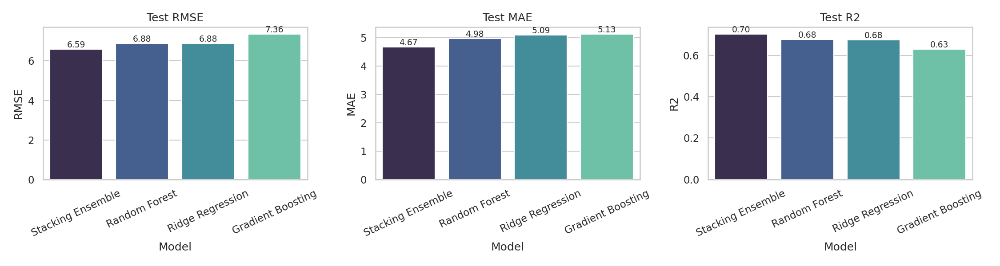
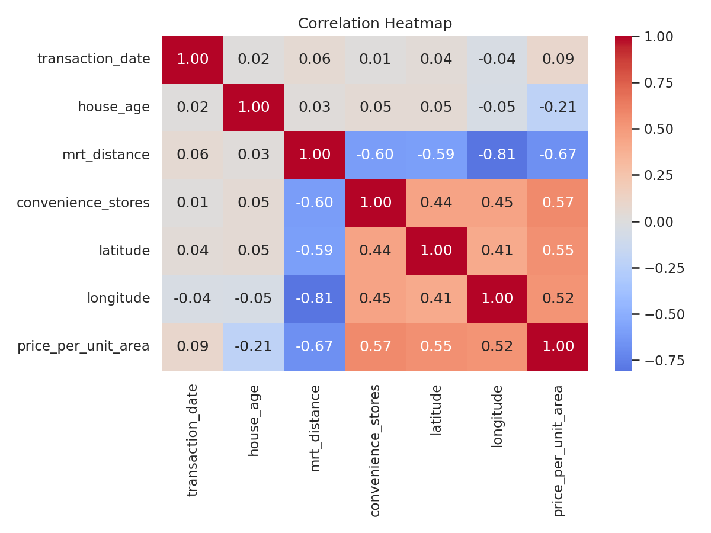
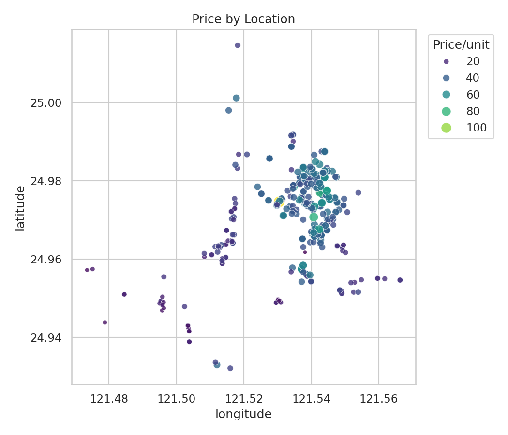
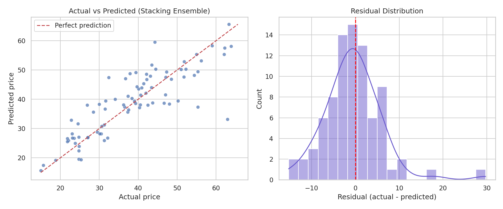
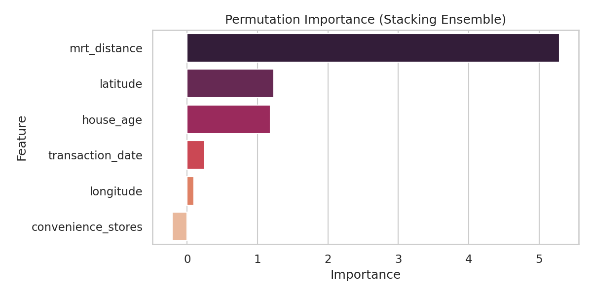

# Real Estate Price Prediction 

A compact end-to-end regression project that predicts house price per unit area from location and property features, comparing three models and a stacking ensemble.

## Problem Statement
Given a property's age, distance to the nearest MRT (metro) station, number of nearby convenience stores, and coordinates, predict its price per unit area. Accurate valuation supports pricing advice, investment screening, and neighborhood comparison.

## Dataset
- **Source:** [UCI Machine Learning Repository, Real Estate Valuation (ID 477)](https://archive.ics.uci.edu/dataset/477/real+estate+valuation+data+set)
- **Size:** 414 transactions, 6 features, 1 target, no missing values
- **Area:** Sindian District, New Taipei City, Taiwan (2012–2013)

| Feature | Description |
|---|---|
| `transaction_date` | Date of sale (decimal year, e.g. 2013.250 = March 2013) |
| `house_age` | Age of the house in years |
| `mrt_distance` | Distance to the nearest MRT station (metres) |
| `convenience_stores` | Number of convenience stores within walking distance |
| `latitude`, `longitude` | Geographic coordinates |
| `price_per_unit_area` | **Target:** price per unit area (10,000 NTD/ping) |

## Approach
1. **Load and inspect:** shape, dtypes, missing values, duplicates, summary statistics
2. **EDA:** target distribution, correlation heatmap, price vs features, location price map, price by store count (all Seaborn)
3. **Preprocessing:** log transform on the skewed `mrt_distance`, standard scaling, all inside a pipeline to prevent data leakage
4. **Stratified 80/20 split:** stratified on price quintiles, since the target is continuous
5. **Model training:** Ridge, Random Forest, and Gradient Boosting, each scored with 5-fold cross-validation
6. **Evaluation:** RMSE, MAE, R² on the held-out test set, plus actual-vs-predicted and residual plots
7. **Justification and interpretation:** reasoning for each algorithm, plus permutation importance
8. **Stacking ensemble:** the three models combined with a RidgeCV meta-learner

## Results

| Model | RMSE | MAE | R² |
|---|---|---|---|
| Ridge Regression | [6.88] | [5.09] | [0.67] |
| Random Forest | [6.87] | [4.97] | [0.67] |
| Gradient Boosting | [7.35] | [5.12] | [0.62] |
| Stacking Ensemble | [6.58] | [4.67] | [0.70] |



**Best model:** [model name]. [One sentence on whether stacking beat the best single model and by how much.]

## Key Insights
- **Best Model** The Stacking Ensemble is the best model. It has the lowest RMSE (6.588) and MAE (4.673) and the highest R² (0.703) of the four, so it wins on all three metrics.

## Key Insights
- **Stacking gave the best result on every metric.** It cut RMSE from 6.88 (Random Forest) to 6.59 and explained about 70% of the variance in price (R² = 0.703). Combining a linear model with tree models helped because they make different kinds of errors.
- **A simple linear model nearly matched the complex ones.** Ridge (RMSE 6.883) is essentially tied with Random Forest (6.878). After the log transform on MRT distance, the price relationships are mostly linear, so extra model complexity adds little.
- **Gradient Boosting performed worst (RMSE 7.358).** With only about 330 training rows, boosting likely overfits. It would probably need tighter tuning, such as fewer trees or stronger regularization.
- **Typical error is about 4.7 price units (MAE).** RMSE is noticeably higher at 6.6, which suggests a few large misses, likely on unusually priced properties, are pulling it up.
- **About 30% of price variation is unexplained.** The dataset lacks factors like floor area, building condition and floor level, so adding those features is the most likely route to better accuracy.
- **Treat the top three rankings cautiously.** The test set is only about 83 rows, so small gaps (like Ridge vs Random Forest) are not strong evidence that one is better.

## Figures
Saved in [`images/`](images/).

**Correlation Heatmap**

**Location price map**

**Best Model Diagnostics**

**Permutation Importance**


## How to Run
```bash
git clone https://github.com/aghnikpaul/real_estate_valuation_regression
cd [real_estate_valuation_regression]
pip install pandas numpy scikit-learn seaborn matplotlib ucimlrepo openpyxl
python real_estate_valuation_master.py
```
The script downloads the data through `ucimlrepo`. If that fails, place `Real estate valuation data set.xlsx` from the UCI page in the project folder.

## Tech Stack
Python · pandas · NumPy · scikit-learn · Seaborn · Matplotlib

## Limitations and Next Steps
- Small dataset (414 rows) from one district and a short time window, so results may not generalize to other markets
- No hyperparameter tuning beyond sensible defaults
- Next: tune with `GridSearchCV`/`Optuna`, try XGBoost or LightGBM, add prediction intervals

## Citation
Yeh, I. C., & Hsu, T. K. (2018). Building real estate valuation models with comparative approach through case-based reasoning. *Applied Soft Computing*, 65, 260–271.

## Author
**Aghnik Paul**:
Data Analysis · Machine Learning · Business Analysis
[Portfolio](https://aghnikpaul.page.gd) · [LinkedIn](https://www.linkedin.com/in/aghnikpaul)
